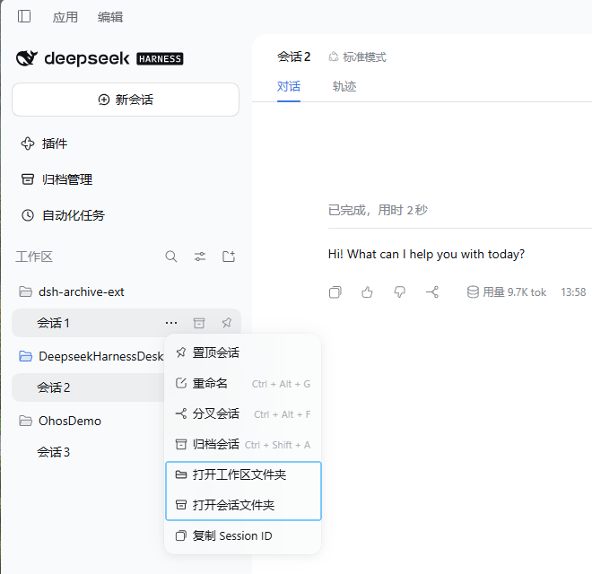
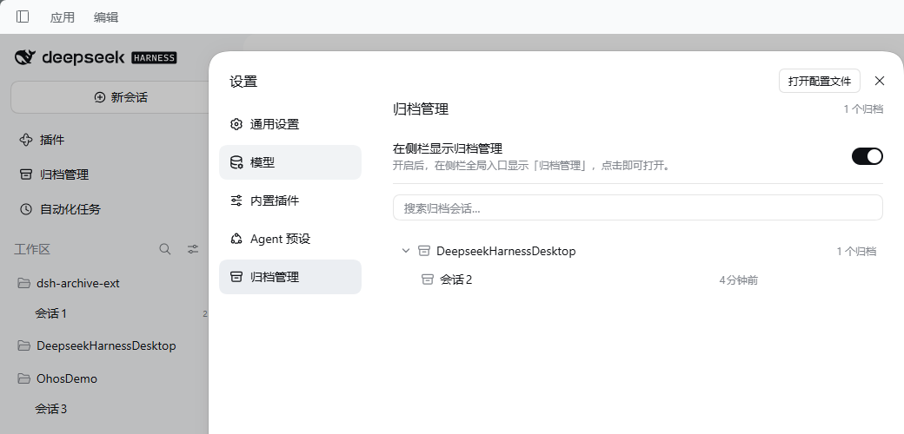

# dsh-archive-ext

为 DeepSeek Harness（DSH）Web UI 提供归档管理与会话目录快捷入口的独立插件。

它把两类常用操作集中起来：

- 在会话 “…” 菜单中直接打开该会话的工作区文件夹或日志文件夹；
- 在「设置 → 归档管理」中集中查看、搜索、取消归档或永久删除已归档会话。

插件只向 DSH 的会话菜单添加入口，不替换或改写内置菜单项，也不依赖其他第三方插件。

## 预览 



## 功能特性

### 会话菜单快捷入口

- **打开工作区文件夹**：打开当前会话所属的工作区目录。
- **打开会话文件夹**：打开该会话的日志目录（通常在 `~/.dsh/sessions/.../session-<id>/`）。
- 使用系统文件管理器：Windows Explorer、macOS Finder、Linux `xdg-open`。
- 会话日志尚未生成时，会显示可读提示，而不是打开错误路径。

### 归档管理

- 入口位于「设置 → 归档管理」。
- 已归档会话按工作区分组、按更新时间倒序排列。
- 支持按标题 / 项目名 / 路径搜索，并可按工作区折叠。
- **取消归档**：会话回到侧栏对应工作区。
- **永久删除**：删除会话日志目录、立即移除归档记录，并尝试释放内存中的 live 会话；操作前需要二次确认。
- 运行中的智能体会被拒绝删除。
- 日志已不存在的无效归档记录会单独分组，可直接清理。

### 可选侧栏入口

- 设置页内提供「在侧栏显示归档管理」开关。
- 开启后，侧栏全局区域出现「归档管理」入口，点击在主界面打开归档管理面板。
- 开关状态保存在当前浏览器的 `localStorage`，不跨浏览器同步。

## 兼容性

- DSH `0.1.7` 及以上；当前验证运行时为 `0.2.1-rc.2`。
- Web UI 与 Desktop 均可使用。
- Windows 优先验证；macOS / Linux 使用对应的系统命令打开目录。

## 安装

从 npm 安装：

```bash
dsh plugin --profile desktop add @ancircle0/dsh-archive-ext
```

需要固定版本时：

```bash
dsh plugin --profile desktop add @ancircle0/dsh-archive-ext@0.1.3
```

本地开发可直接使用仓库目录：

```bash
dsh plugin --profile desktop add /path/to/dsh-archive-ext
```

Windows 示例：

```bash
dsh plugin --profile desktop add C:\path\to\dsh-archive-ext
```

安装或更新后，请**完全退出并重新启动 DSH**。仅刷新页面不会重新加载 Host 插件代码。

卸载：

```bash
dsh plugin --profile desktop remove @ancircle0/dsh-archive-ext
```

> 桌面版 profile 由 Electron 应用管理；安装后请完全退出应用再启动，不要只刷新页面。

## 使用说明

### 打开会话目录

在任意会话行点击 “…”：

- **打开工作区文件夹**：打开该会话所属的工作区目录。
- **打开会话文件夹**：打开该会话的日志目录。

如果会话还没有生成日志（例如刚创建、尚未产生内容），「打开会话文件夹」会提示「会话日志尚未生成或已被删除」。

### 归档管理

打开 **设置 → 归档管理**：

1. 已归档会话按工作区分组展示；
2. 可用顶部搜索框按标题、项目名或路径过滤；
3. 行内提供「取消归档」与「永久删除」；
4. 无效归档记录会单独分组，仅允许清理。

> **永久删除不可恢复。** 确认后会删除该会话的日志目录并立即移除归档记录。如果该会话仍驻留在内存中，插件会尝试释放；释放失败时，普通会话列表可能要到重启 DSH 后才完全消失，插件会显示提示。

### 侧栏入口

在设置页打开「在侧栏显示归档管理」后，侧栏会出现「归档管理」入口；关闭开关会移除该入口。开关只影响当前浏览器。

## 权限与数据

- 插件本身**不发起网络请求，也不采集遥测数据**。
- 通过 DSH 提供的服务读取工作区与会话元数据，并读写归档状态。
- 只对解析出的工作区目录或会话日志目录执行操作；不会浏览其他路径。
- 打开文件夹时调用系统文件管理器命令。
- 永久删除只在用户二次确认后执行，且不可恢复。
- 侧栏开关仅保存在浏览器 `localStorage`（key `dsh-archive-ext.sidebar`）。

## 已知限制

- 工作区行 “…” 菜单暂不支持插件添加入口，因此入口位于会话行 “…” 菜单；插件不替换 DSH 原生菜单项。
- 「打开会话文件夹」依赖会话日志已持久化。
- 永久删除不可恢复。
- DSH 升级若调整插件接口，插件可能需要同步适配。

## 开发

```bash
npm install --ignore-scripts
npm run check
npm test
npm run verify
```

- `npm run check`：JavaScript 语法检查。
- `npm test`：核心逻辑与设置页图标增强的单元测试。
- `npm run verify`：Host/Client 接口契约与 client 装配冒烟测试。

设计决策、接口契约、实现细节、测试与变更记录统一维护在 [PLAN.md](PLAN.md)。

## 贡献

欢迎提交 issue 或 PR。修改行为前请先阅读 [PLAN.md](PLAN.md)：本项目以计划为单一事实来源，代码、测试、文档与验收项需要保持一致。

## 许可证

[MIT](LICENSE)
